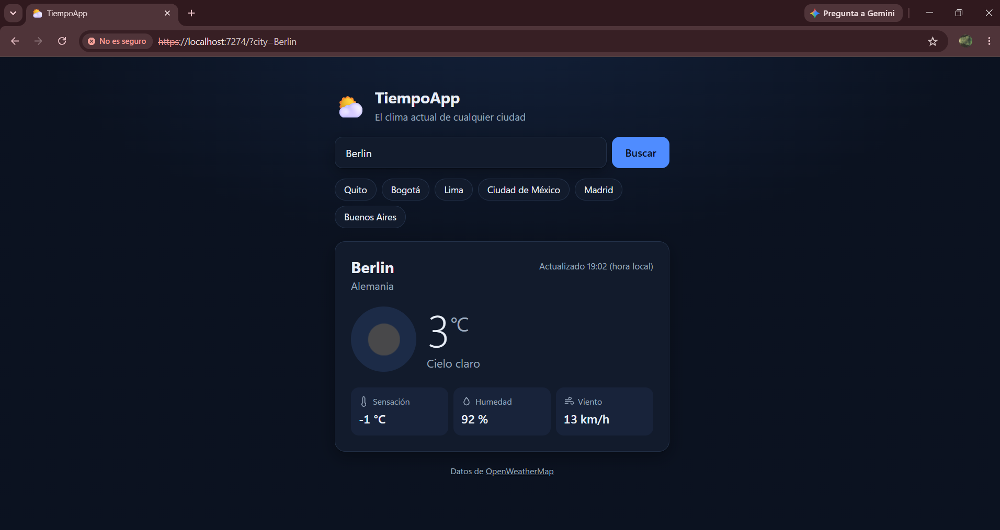
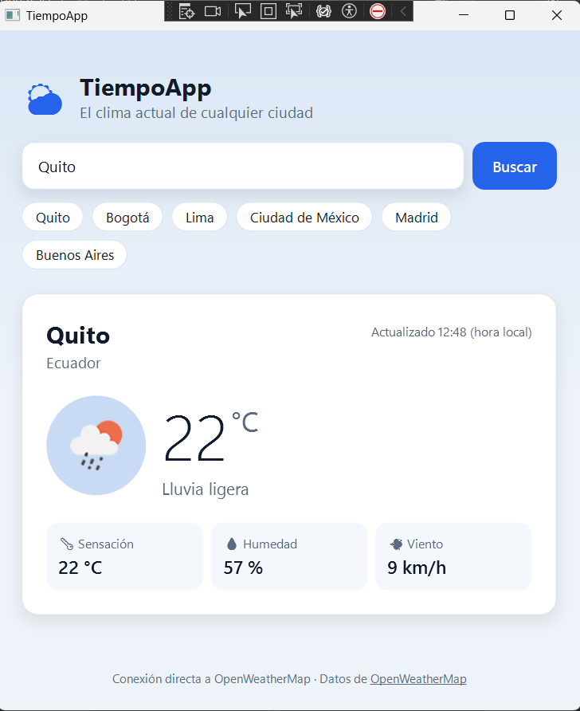
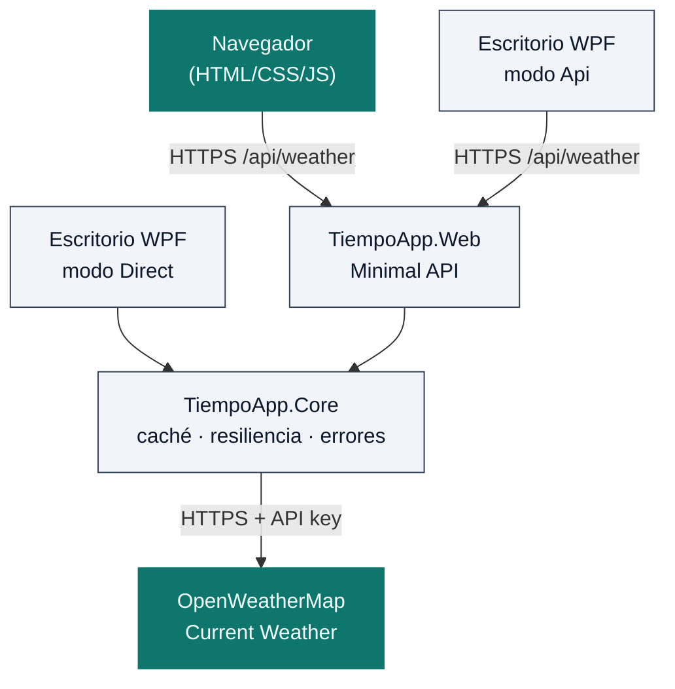

<div align="center" style="padding: 2% 0;">

# TiempoApp

<p>
  
  
  
  
</p>

<p>
  
  
  
  
  
</p>

</div>


Consulta el **clima actual de cualquier ciudad** con la API de [OpenWeatherMap](https://openweathermap.org/) y lo muestra en una **web responsive** y en una **app de escritorio para Windows** que comparten la misma lógica.

Es una **demostración**. Los datos meteorológicos son reales.

---

## Capturas

<!-- Capturas: añadir en docs/img/ -->
| Web | Escritorio |
|---|---|
|  |  |

## Descripción

Una librería compartida en **.NET 10** (`TiempoApp.Core`) encapsula el cliente de OpenWeatherMap, la caché, la resiliencia y el modelo de errores. Sobre ella hay dos interfaces:

- **Web**: Minimal API de **ASP.NET Core** (`/api/weather`, `/health`) y una página estática en HTML/CSS/JS con tema claro y oscuro.
- **Escritorio**: **WPF** con MVVM (CommunityToolkit.Mvvm), con los mismos colores y textos que la web.
- **La API key nunca sale del servidor**: el navegador no la ve y el escritorio entregado a clientes consulta la web en lugar de llamar a OpenWeatherMap.

La guía de despliegue completa está en [`docs/DEPLOY.md`](docs/DEPLOY.md).

## Características

| Característica | Descripción |
| --- | --- |
| **Búsqueda por ciudad** | Campo de búsqueda, accesos rápidos (Quito, Bogotá, Lima, Ciudad de México, Madrid, Buenos Aires) y enlace directo `/?city=Quito`. |
| **Datos mostrados** | Temperatura, sensación térmica, humedad, viento, descripción en español, icono y hora local de la ciudad. |
| **Caché** | 10 minutos por ciudad con `IMemoryCache` para cuidar el límite del plan gratuito. Los errores no se cachean. |
| **Resiliencia** | Reintentos, timeouts por intento y total, y circuit breaker con `Microsoft.Extensions.Http.Resilience`. |
| **Errores claros** | Ciudad no encontrada, límite de consultas, proveedor lento o caído y API key inválida, con mensajes en español. La API responde `ProblemDetails` (RFC 9457). |
| **Estados de la interfaz** | Vacío, cargando (skeleton), error y resultado; la búsqueda en curso se cancela si se lanza otra. |
| **Tema claro y oscuro** | La web sigue la preferencia del sistema. Los tokens de diseño están replicados en el escritorio. |
| **Dos modos de escritorio** | `Direct` (llama a OpenWeatherMap, para demos locales) o `Api` (llama a la web desplegada, sin API key). |
| **Documentación de la API** | OpenAPI + Scalar en `/scalar`, solo en Development. |
| **Contenedor** | Dockerfile multi-stage, usuario no root, puerto 8080 y health check en `/health`. |

## Arquitectura



| Proyecto | Rol |
| --- | --- |
| `src/TiempoApp.Core` | Cliente tipado de OpenWeatherMap, caché, opciones validadas, DTOs y modelo de errores compartido. |
| `src/TiempoApp.Web` | Minimal API (`/api/weather`, `/health`), OpenAPI + Scalar y frontend estático en `wwwroot`. |
| `src/TiempoApp.Desktop` | App WPF con MVVM; elige el origen de datos (`Direct` o `Api`) en `appsettings.json`. |
| `tests/TiempoApp.Tests` | Pruebas del cliente, la caché, la resiliencia, el cliente del modo `Api` y los endpoints. |

## Estructura del proyecto

```text
TiempoApp/
├── 📁 src/
│   ├── 📁 TiempoApp.Core/            # librería compartida
│   │   ├── 📁 Models/                # respuesta de OpenWeatherMap y WeatherDto
│   │   ├── 📁 Options/               # OpenWeatherOptions (validadas al inicio)
│   │   └── 📁 Services/              # OpenWeatherClient, caché, cliente de la API y errores
│   ├── 📁 TiempoApp.Web/             # ASP.NET Core Minimal API
│   │   ├── 📁 Endpoints/             # GET /api/weather y mapeo a ProblemDetails
│   │   └── 📁 wwwroot/               # index.html, styles.css y app.js
│   └── 📁 TiempoApp.Desktop/         # WPF + CommunityToolkit.Mvvm
│       ├── 📁 ViewModels/            # MainViewModel y textos formateados
│       └── 📁 Views/                 # MainWindow
├── 📁 tests/
│   └── 📁 TiempoApp.Tests/           # xUnit: Core, Web y fakes HTTP
├── 📁 docs/                          # DEPLOY.md y capturas
├── 📄 Dockerfile                     # imagen de la Web (sdk → aspnet, no root)
├── 📄 Directory.Build.props          # C# 14, nullable, analizadores
├── 📄 Directory.Packages.props       # versiones NuGet centralizadas
├── 📄 TiempoApp.slnx                 # solución
├── 📄 TiempoApp.slnLaunch            # perfil «Web + Desktop» de Visual Studio
└── 📄 README.md
```

## Stack tecnológico

| Categoría | Tecnología |
| --- | --- |
| Runtime | .NET 10 |
| Lenguaje | C# 14 con nullable y warnings como errores en Release |
| API | ASP.NET Core Minimal API, `ProblemDetails`, health checks |
| Cliente HTTP | `IHttpClientFactory` (typed client), `System.Text.Json` |
| Resiliencia y caché | `Microsoft.Extensions.Http.Resilience`, `IMemoryCache` |
| Documentación | `Microsoft.AspNetCore.OpenApi` + Scalar 2.21 |
| Frontend web | HTML, CSS y JavaScript sin dependencias |
| Escritorio | WPF, CommunityToolkit.Mvvm 8.4, Generic Host |
| Pruebas | xUnit 2.9, `Microsoft.AspNetCore.Mvc.Testing` |
| Contenedor | Docker (`mcr.microsoft.com/dotnet/aspnet:10.0`) |
| Paquetes | Central Package Management |

## Requisitos

- **[.NET SDK 10](https://dotnet.microsoft.com/download/dotnet/10.0)**.
- **Windows 10/11** para la app de escritorio. La web funciona en cualquier sistema.
- **Una API key gratuita de OpenWeatherMap**: [crear cuenta](https://home.openweathermap.org/users/sign_up) → *API keys*. Una key nueva puede tardar hasta unas 2 horas en activarse; mientras tanto responde 401.
- Visual Studio 2026 (opcional) y Docker (solo para el contenedor).

## Comandos

| Comando | Descripción |
| --- | --- |
| `dotnet build TiempoApp.slnx` | Compila toda la solución. |
| `dotnet test TiempoApp.slnx` | Ejecuta las 41 pruebas (ninguna llama a la API real). |
| `dotnet run --project src/TiempoApp.Web --launch-profile https` | Levanta la web en `https://localhost:7274`. |
| `dotnet run --project src/TiempoApp.Desktop` | Abre la app de escritorio. |
| `docker build -t tiempoapp-web .` | Construye la imagen de la web. |
| `docker run --rm -p 8080:8080 -e OpenWeather__ApiKey tiempoapp-web` | Ejecuta el contenedor con la key de la variable de entorno. |
| `dotnet publish src/TiempoApp.Desktop -c Release -r win-x64 --self-contained false -p:PublishSingleFile=true -o dist/desktop` | Genera el `.exe` de escritorio. |

## Configuración y uso

### 1. Configurar la API key

La key **no se guarda en el repositorio**. En local se usa *User Secrets*; la web y el escritorio comparten el mismo almacén, así que basta con configurarla una vez:

```bash
dotnet user-secrets set "OpenWeather:ApiKey" "<TU_API_KEY>" --project src/TiempoApp.Web
```

En servidores y contenedores se usa la variable de entorno `OpenWeather__ApiKey`. Si la key falta, la web no arranca y el escritorio muestra un mensaje explicando cómo configurarla.

### 2. Ejecutar la web

```bash
dotnet run --project src/TiempoApp.Web --launch-profile https
```

| URL | Contenido |
| --- | --- |
| `https://localhost:7274` | Aplicación (también `/?city=Quito`) |
| `https://localhost:7274/api/weather?city=Quito` | API JSON |
| `https://localhost:7274/scalar` | Documentación interactiva (solo Development) |
| `https://localhost:7274/health` | Health check |

Si el navegador advierte del certificado: `dotnet dev-certs https --trust`.

### 3. Ejecutar el escritorio

```bash
dotnet run --project src/TiempoApp.Desktop
```

El origen de los datos se elige en `src/TiempoApp.Desktop/appsettings.json`:

```json
"WeatherSource": {
  "Mode": "Direct",
  "ApiBaseUrl": "https://localhost:7274/"
}
```

| Modo | Cómo obtiene el clima | Cuándo usarlo |
| --- | --- | --- |
| `Direct` | Llama a OpenWeatherMap con la key de User Secrets. | Demo local en tu equipo. |
| `Api` | Llama a `TiempoApp.Web` (local o desplegada). | **Siempre que el `.exe` se entregue a terceros**: una app de escritorio no puede proteger una API key. |

En modo `Api` contra `https://localhost`, el certificado de desarrollo debe ser de confianza. En Visual Studio, el perfil **«Web + Desktop»** (`TiempoApp.slnLaunch`) arranca ambas con F5.

### 4. Desplegar

La web se despliega en Azure App Service, en un contenedor gestionado (Container Apps, Cloud Run o App Runner) o en un VPS con Docker Compose y Caddy. Después, el escritorio se configura en modo `Api` con la URL pública. Los pasos están en [`docs/DEPLOY.md`](docs/DEPLOY.md).

### Ajustes de `appsettings.json` (sección `OpenWeather`)

| Clave | Por defecto | Qué hace |
| --- | --- | --- |
| `Units` | `metric` | `metric` (°C, km/h), `imperial` (°F, mph) o `standard` (K, m/s). |
| `Lang` | `es` | Idioma de las descripciones. |
| `CacheMinutes` | `10` | Minutos de caché por ciudad (`0` la desactiva). |
| `ApiKey` | — | **Solo** en User Secrets o en `OpenWeather__ApiKey`. |

## Pruebas

```bash
dotnet test TiempoApp.slnx      # 41 pruebas xUnit
```

Cubren el mapeo del JSON, los errores 401/404/429/5xx, el JSON inválido, los fallos de red, los reintentos, la caché, el cliente del modo `Api`, los `ProblemDetails` del endpoint y que OpenAPI solo se exponga en Development. Usan un handler HTTP falso y **ninguna llama a la API real**. Si una instancia en Debug bloquea las DLL, añade `-c Release`.

## Documentación

| Documento | Para qué sirve |
| --- | --- |
| [`docs/DEPLOY.md`](docs/DEPLOY.md) | Principios, contenedor, opciones de nube, escritorio y checklist. |
| [Contenedor](docs/DEPLOY.md#contenedor-base-de-las-opciones-b-y-c) | Construir y ejecutar la imagen sin exponer la key. |
| [Azure App Service](docs/DEPLOY.md#opción-a-azure-app-service-la-más-directa-para-net) | Despliegue directo del código .NET. |
| [VPS con Docker Compose](docs/DEPLOY.md#opción-c-vps-con-docker-compose-control-total-bajo-coste) | `compose.yaml`, Caddy y Let's Encrypt. |
| [Aplicación de escritorio](docs/DEPLOY.md#aplicación-de-escritorio) | Publicar el `.exe` y configurarlo para clientes. |
| [Checklist](docs/DEPLOY.md#checklist-previo-a-cualquier-despliegue) | Revisión antes de cualquier despliegue. |

## Información general

- **Nombre del proyecto:** `TiempoApp`
- **Idioma de la interfaz:** español
- **Estado:** demostración funcional. Probada en local (web, escritorio y contenedor Docker); el despliegue en la nube está documentado pero no se ha ejecutado.
- **Notas:**
  - OpenWeatherMap marca la búsqueda por nombre de ciudad (`q=`) como *deprecated*, aunque sigue operativa. Si dejara de funcionar, el cambio se limita a `OpenWeatherClient` (Geocoding API).
  - Algunos nombres de ciudad llegan en inglés aunque se pida `lang=es` (p. ej. «Mexico City»); las descripciones sí llegan en español.
  - El plan gratuito de OpenWeatherMap tiene límite de consultas: la caché ayuda, pero cada instancia tiene la suya.

---

<div align="center">

TiempoApp · Datos de [OpenWeatherMap](https://openweathermap.org/)

</div>
